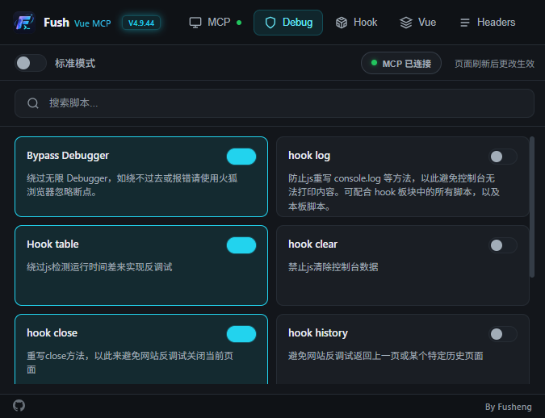
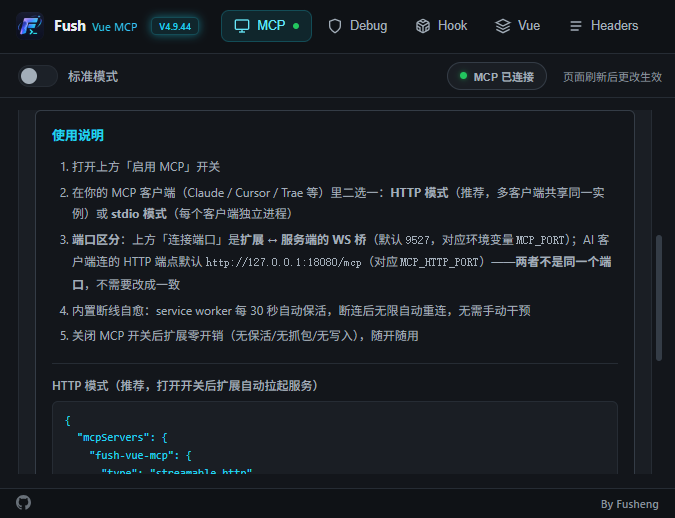
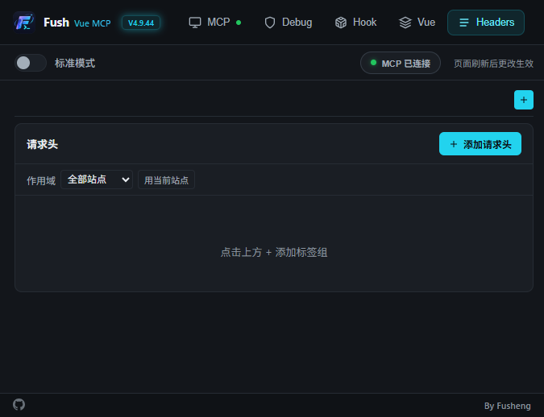

<h1 align="center">
  
  Fush Vue MCP
</h1>

<p align="center">
  <strong>Vue 前端逆向 + Web 安全测试工具（Chrome 扩展 + MCP 服务端）</strong>
</p>

<p align="center">
  
  
  
  
</p>

---

## 📖 简介

**Fush Vue MCP** 是一款聚焦 **Vue 前端逆向** 与 **Web 安全测试** 的工具，由两部分组成：

- 🧩 **Chrome 扩展**：反调试绕过、API Hook、Vue 路由 / 权限分析、请求头改包、抓包与加密参数捕获
- 🤖 **MCP 服务端**：**91 个工具**，让 AI（Claude / Codex 等支持 MCP 的客户端）直接操作浏览器
  —— 点击 / 输入 / 拖拽 / 上传 / 环境模拟 / 截图 / 抓包 / 读源码 / 越权扫描

> 🧠 **定位**：AI 的 Web 漏洞挖掘副驾，不是扫描器。工具的输出是给 AI 的**分诊原料**，不是最终结论
> —— 扫描器会漏掉的逻辑漏洞 / 越权组合 / 业务缺陷，才是它的价值所在。

## 🖼️ 界面预览

<p align="center">
  
  
</p>
<p align="center">
  
</p>

## ✨ 功能特性

### 🌐 Vue 逆向（重点方向）

| 能力 | 说明 |
|---|---|
| 路由获取 | 提取 Vue Router 全部路由、组件路径、meta 信息 |
| 路由守卫清除 | 绕过前端路由守卫，直接访问受限页面 |
| 路由未授权扫描 | 批量探测路由是否需要登录、是否泄露数据 |
| Store / 权限分析 | Pinia / Vuex 全量 dump、页面按钮级权限矩阵 |
| 深链绕过 | 未登录状态下清洗导航守卫，直接跳转目标路由 |
| Nuxt 探测 | Nuxt payload 端点探测（跨用户 SSR 数据风险） |

### 🛡️ 反调试与 Hook

- **反调试绕过**：无限 Debugger、`eval` / `Function` 劫持、时间差检测、窗口尺寸检测、`console` 重写
- **Hook 能力**：XHR / Fetch / WebSocket / CryptoJS / JSEncrypt / WebCrypto / Storage / Cookie / JSON / Promise
- **加密参数捕获**：请求与响应的加密参数自动对照，便于还原签名算法

### 📝 请求头改包

ModHeader 式能力：新增 / 修改 / 删除 / 分组 / 导入导出 / 按站点作用域控制。

### 🤖 MCP 集成（91 个工具）

- **浏览器操作**：点击 / 输入 / 拖拽（含滑块验证码）/ 上传文件 / 环境模拟（UA / 视口 / 时区 / 地理 / 限速）/ 截图
- **侦察与抓包**：网络请求 / Cookie / Storage / DOM / JS chunk 源码 / 页面性能
- **安全测试**：越权批量验证 / 敏感数据扫描 / 加密分析 / 反调试清障
- **多标签 / 多客户端**：`tab_id` / `hostname` 三级解析；HTTP 模式下一个服务实例服务多个 AI 会话

## 📥 下载安装

> 系统要求：**Windows 10/11** + Chrome / Edge **≥ 116** + Node.js **≥ 18**

### ① 安装扩展

1. 到 [Releases](https://github.com/fush520/fush-vue-mcp/releases) 下载 **`fush-extension-v4.9.44.zip`** 并解压
2. 打开 `edge://extensions`（Chrome 是 `chrome://extensions`）→ 开启「**开发者模式**」
3. 点「**加载已解压的扩展程序**」→ 选择解压出来的目录（含 `manifest.json` 的那一层）
4. 扩展 ID 由 `manifest.key` 固定：`gehffcnnfpebmbemfnkoflchkobghjeh`

### ② 配置 MCP（可选，但推荐）

1. 下载 **`fush-source-v4.9.44.zip`** 并解压
2. 安装服务端依赖（会自动构建）：

   ```bash
   cd <解压目录>/mcp-server
   npm install
   ```

3. 在 MCP 客户端（Claude / Codex / Qoder / Trae 等）里二选一：

   **HTTP 模式（推荐，多客户端共享同一实例）**

   ```json
   {
     "mcpServers": {
       "fush-vue-mcp": {
         "type": "streamable-http",
         "url": "http://127.0.0.1:18080/mcp"
       }
     }
   }
   ```

   **stdio 模式（每个客户端独立进程）**

   ```json
   {
     "mcpServers": {
       "fush-vue-mcp": {
         "command": "node",
         "args": ["<解压目录>/mcp-server/dist/index.bundle.cjs"],
         "env": { "MCP_PORT": "9527" }
       }
     }
   }
   ```

4. 打开插件里的「**启用 MCP**」开关 → 状态变为「已连接」

> ⚠️ **端口区分**：扩展的「连接端口」是**扩展 ↔ 服务端的 WS 桥**（默认 `9527`，环境变量 `MCP_PORT`）；
> AI 客户端连的是 **HTTP 端点**（默认 `http://127.0.0.1:18080/mcp`，环境变量 `MCP_HTTP_PORT`）。
> **两者不是同一个端口**，不需要改成一致。

## 🚀 快速上手

在支持 MCP 的 AI 客户端里直接说：

```text
请帮我用 Fush 分析当前页面的 Vue 路由，并检测未授权访问：
1. 获取所有路由
2. 批量探测哪些路由不需要登录
3. 检查路由返回里有没有敏感数据
```

或直接操作浏览器：

```text
帮我打开 https://example.com，截个图，然后把所有网络请求的响应头列出来
```

## ⚠️ 注意事项

| ⚠️ | 说明 |
|---|---|
| 🦊 | 目前**不支持火狐浏览器**（依赖 Chrome DevTools Protocol） |
| 🔄 | 开启 / 关闭脚本后需**刷新页面**才生效 |
| 📍 | **无法自动添加**未加载的 Vue 路由（需页面已注册） |
| 🗑️ | 更新插件时请**先移除旧版本**再加载新版 |
| 🖥️ | MCP 服务端**只监听本机**（127.0.0.1），不对公网开放 |

## ⚠️ 免责声明

本项目（Fush Vue MCP）**仅用于经授权的安全测试**：甲方授权渗透、企业 SRC、众测平台、自建靶场、教学研究等。

- 使用者须自行确保对目标拥有**合法授权**。未经授权对他人系统进行测试属于违法行为，**后果由使用者自行承担**。
- 本项目不针对任何特定目标、不附带任何目标信息；工具输出仅为**分析原料**，不构成漏洞结论。
- 项目作者不对使用本工具造成的任何直接或间接损失承担责任。
- MCP 集成会让 AI 直接操作浏览器——**请在测试专用的浏览器配置/环境中使用**，不要在存有敏感登录态的日常环境里开启高风险操作。
- 请遵守你所在国家/地区的法律法规与目标平台的测试协议。

## ⚖️ 许可证

**本项目不是 MIT 项目，也不声称任何开源许可证。**

- **扩展与 MCP 服务端**：受 [LICENSE.md](LICENSE.md) 约束——**未经授权禁止商业用途**
- **`scripts/` 下的 Hook 脚本**：参考 / 引用了若干开源实现，各文件头部保留原作者 `@author` 署名，
  其使用受原作者许可约束
- 第三方依赖（MCP SDK / ws 等）遵循各自许可证

## 🙏 致谢

`scripts/` 下的 Hook 脚本与部分前端能力参考 / 引用了以下开源实现（各脚本头部保留原作者署名）：

- [Hook_JS](https://github.com/AntSwordProject/Hook_JS)
- [VueCrack](https://github.com/AntSwordProject/VueCrack)
- [FakeCryptoJS](https://github.com/AntSwordProject/FakeCryptoJS)
- [vue-force-dev](https://github.com/AntSwordProject/vue-force-dev)

MCP 工具面的接口形态参考了若干浏览器 MCP 项目的通用能力，实现独立。

---

## 📚 更多文档

- [MCP 客户端安装教程](docs/)（Codex / Qoder / Trae）
- [更新日志（精简版）](CHANGELOG.public.md)
- [安全策略](SECURITY.md)
